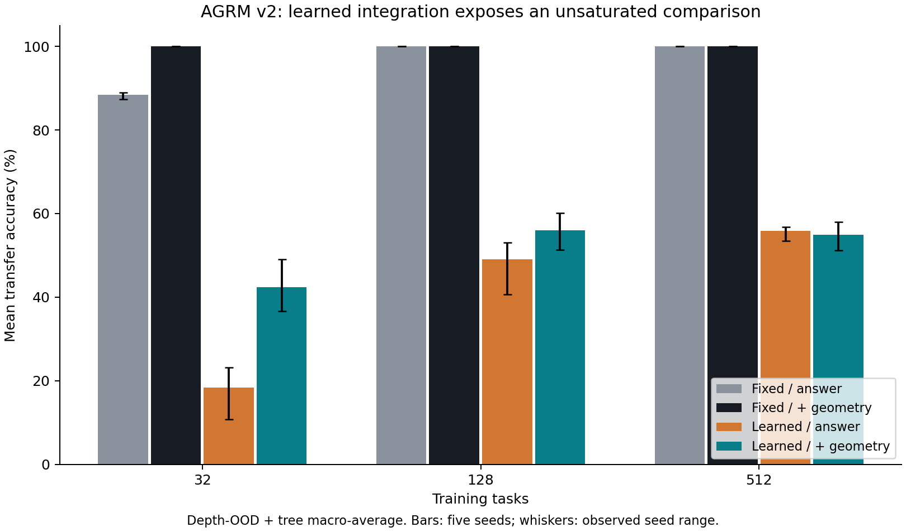
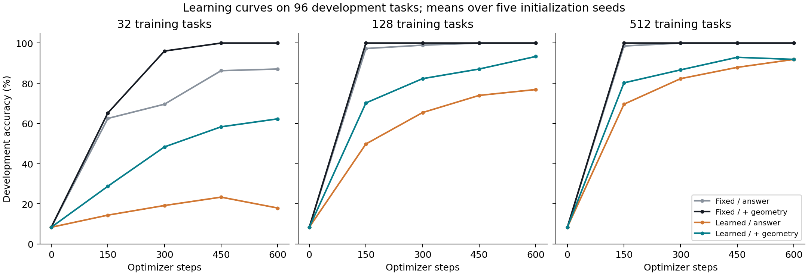

# AGRM v2: does geometry supervision help learned graph integration?

**Completed 23 September 2026. Result: retain for independent replication.**

Auxiliary geometry supervision improved the learned model's prespecified
transfer score by **10.04 percentage points**, averaged equally across three
training-data sizes and five initialization seeds. All five seed-level average
differences were positive, passing the frozen practical evidence gate.
The benefit was concentrated in the two smaller training sets. At 512 tasks,
geometry supervision reduced the mean score by **0.94 points**.

This is a narrow positive result about an auxiliary training objective under
limited data. It is not an improvement over the fixed solver, which remains
substantially more accurate and cheaper on this exact additive task. Extra
coordinate supervision and missing answer classes in the smallest subset are
important alternative explanations. Neither general intelligence nor an
undisclosed Sophontic mechanism is established.

## 1. Why run this experiment?

V1 used learned relation embeddings followed by an exact least-squares graph
integrator. Both answer-only and geometry-supervised models saturated its final
accuracy. That did not distinguish the contribution of geometry supervision
from the powerful supplied solver.

V2 keeps the existing data algebra and common answer head but crosses two
integration methods with two objectives. The learned architecture has no graph
solve or coordinate oracle at inference. Its local message updates must learn
how to combine relation information. This removes the specific integrator
confound while retaining other explicit priors and the extra-label confound.

## 2. Frozen design and mathematics

The protocol and model source were committed as
`4a4a28966d0b5e8869039466e337f0066d795a93` before the 60 research runs.
The local freeze was recorded at 16:43:24 UTC. Final scoring began at 16:48:06
UTC, after all checkpoint hashes were recorded. No failed run was discarded,
no hyperparameter or model implementation was changed after freezing, and no
checkpoint was selected using development or final-set performance.
This was a local freeze, not externally witnessed preregistration.

| Factor | Values |
|---|---|
| Integration | Fixed least-squares; learned local messages |
| Geometry weight | 0; 0.2 |
| Training tasks | 32; 128; 512, nested and depth-balanced |
| Initialization seeds | 103; 211; 307; 401; 503 |
| Budget | 600 updates, batch 32, Adam learning rate 0.01 |
| Curriculum | Depth 1, then 1-2, then 1-3, then 1-4 |
| Final data | 256 tasks in each of five families |
| Primary families | Depth 6-12 chains and 14-node trees |

Within each architecture, objective pairs start with identical weights and use
identical training examples and batch draws. All models share one training
pool and one final evaluation seed. Only initialization is replicated.
Every run processes 19,200 training examples including repeats; unique training
set size is a separate factor. A nine-task pre-freeze learning control reached
100% training accuracy and established basic capacity, not generalization.

For incidence matrix B, relation embeddings R, and anchor diagonal D, the fixed
model computes

$$Z=(B^\top B+D)^{-1}B^\top R.$$

Implementation uses a linear solve. Both v2 architectures anchor the queried
reference node at zero; this differs from v1's gauge but is shared across all
v2 arms. V1 source and artifacts remain unchanged.

The learned model uses 16 rounds of shared local message passing:

$$m_{u\to v}^{(t)}=\operatorname{MLP}
([h_u^{(t)},h_v^{(t)},s_{uv}r_e,a_u,a_v]),$$
$$h_v^{(t+1)}=\operatorname{GRU}
\left(\operatorname{mean}_{u\sim v}m_{u\to v}^{(t)},h_v^{(t)}\right),
\qquad z_v=Ph_v^{(16)}.$$

The sign s records traversal direction, a indicates an anchor, and P is a
learned linear projection. Anchors and padding are clamped to zero. The common
answer head maps the query difference to horizontal and vertical sign
probabilities and their nine-class joint distribution. This head remains an
explicit structural prior.

The auxiliary objective matches anchored Gram matrices, with a padding mask M:

$$\mathcal L=\mathcal L_{\mathrm{answer}}+\lambda\mathcal L_{\mathrm{geometry}},
\qquad
\mathcal L_{\mathrm{geometry}}=
\operatorname{mean}_{\mathrm{tasks}}
\frac{\lVert M\odot(ZZ^\top-XX^\top)\rVert_F^2}
{\max(1,\lVert M\odot XX^\top\rVert_F^2)}.$$

X is the exact training-coordinate target. Gram matching allows orthogonal
changes of latent basis but constrains geometry and scale. These coordinate
labels are additional supervision; they are absent from inference.

The primary score is the mean raw accuracy on the two declared transfer
families. For each seed, the geometry-minus-answer contrast is averaged equally
over the three data sizes. The gate requires a five-seed mean of at least
five percentage points and a strictly positive average for every seed.
It is a practical retention rule, not a powered population hypothesis test.
The full specification is in [the protocol](AGRM_V2_PROTOCOL.md).

## 3. Primary results

Entries are percentages, averaged across five initialization seeds. The final
column is the learned-model difference in percentage points, calculated before
rounding.

| Training tasks | Fixed: answer | Fixed: + geometry | Learned: answer | Learned: + geometry | Learned difference |
|---:|---:|---:|---:|---:|---:|
| 32 | 88.36 | 100.00 | 18.40 | 42.46 | +24.06 |
| 128 | 100.00 | 100.00 | 49.02 | 56.02 | +6.99 |
| 512 | 100.00 | 100.00 | 55.82 | 54.88 | -0.94 |
| Equal-size mean | 96.12 | 100.00 | 41.08 | 51.12 | **+10.04** |

| Seed | Learned difference, averaged over data sizes |
|---:|---:|
| 103 | +8.20 points |
| 211 | +15.30 points |
| 307 | +6.97 points |
| 401 | +5.66 points |
| 503 | +14.06 points |

The frozen gate passes. At 32 and 128 tasks, every seed has a positive
difference. At 512 tasks, three seeds have negative differences and two have
positive differences. The positive overall result must not be presented as
uniform improvement across data sizes.

The fixed architecture with geometry supervision scored 100% on every final
family in every seed and data-size condition. Its answer-only control also
saturated at 128 and 512 tasks. Thus v2 does not identify a better solver for
this benchmark; it identifies a training-objective effect after removing a
supplied solution method. The small-data fixed-arm gain also shows that the
effect is not unique to recurrent integration.

## 4. Data coverage and learning curves

**The 32-task subset has no S or O answer labels.** Its answer histogram is
E=3, N=5, NE=6, NW=7, SE=5, SW=3, W=3. The 128- and 512-task subsets contain
all nine answer classes. The subsets were depth-balanced, not answer-balanced,
as specified before training. We retain this result rather than repairing the
subset after seeing performance.

The absence of two answer classes makes the smallest-data regime an especially
strong test of shared structure and auxiliary labels, but a weaker basis for
a general sample-efficiency claim. Five model seeds do not replicate this data
sampling event. The 128-task gain provides a positive observation with all
classes represented, still on only one data pool.

Development curves use 96 separate short-chain tasks. They show a substantial
small-data benefit and similar final development accuracy at 512 tasks. They
were logged at fixed steps and did not choose a checkpoint. Training accuracy
averaged 89.31% for learned answer-only models and 98.22% for learned models
with geometry supervision across all sizes and seeds. Better optimization of
the training task is therefore another plausible contributor, not an excluded
explanation.

## 5. Counterfactuals, invariance, and confidence

There are 989 eligible one-edge counterfactual pairs per model: 254 IID, 255
composition, 227 depth-OOD, and 253 tree cases. The remaining 35 candidates in
those four families had no eligible answer-changing perturbation under the
generator's rule. Cyclic-grid cases are excluded from this metric because a
single exact edge change generally makes the cycle inconsistent. A successful
pair requires both answers correct.

| Training tasks | Learned answer-only: both correct | Learned + geometry: both correct |
|---:|---:|---:|
| 32 | 1.86% | 28.55% |
| 128 | 44.39% | 61.01% |
| 512 | 62.12% | 59.31% |

These descriptive secondary results follow the same small-data pattern.
All models had 100% label consistency under node renaming and node/fact
reordering on the tested final instances. Consistency alone is not correctness.

At the fixed confidence threshold of 0.6, pooled primary-family metrics across
all three sizes and five seeds are:

| Learned objective | Raw accuracy | Coverage | Accuracy among accepted | Abstentions counted wrong |
|---|---:|---:|---:|---:|
| Answer only | 41.08% | 73.87% | 49.02% | 36.21% |
| Answer + geometry | 51.12% | 83.33% | 55.73% | 46.45% |

These denominators contain repeated evaluation of the same task set across
models; they are descriptive counts, not 7,680 independent task draws.
The learned model's confidence is plainly insufficient as a correctness gate.
High confidence remains advice, never authorization. Every family and raw
prediction is included in the machine-readable results and `metrics.csv`.

## 6. Cost

The measurement environment was Python 3.12.14, PyTorch 2.14.0+cpu, one CPU
thread. Training times exclude setup and development scoring; inference uses
batches of 32 depth-OOD tasks after a warmup and three measured repetitions.

| Architecture/objective | Parameters | Mean training seconds | Forward ms/example | Preprocessing ms/example |
|---|---:|---:|---:|---:|
| Fixed / answer | 180 | 0.74 | 0.011 | 0.403 |
| Fixed / + geometry | 180 | 0.76 | 0.011 | 0.405 |
| Learned / answer | 4,228 | 7.79 | 0.232 | 0.416 |
| Learned / + geometry | 4,228 | 7.30 | 0.236 | 0.410 |

Total recorded training time was 248.92 seconds for all 60 runs. These are
local wall-clock measurements affected by execution order and host load,
including other local validation work. The slightly shorter observed time in
the learned geometry arm is not evidence that its objective is computationally
cheaper. Both objectives compute the geometry term for logging.

The learned architecture has approximately 23.5 times as many parameters and
about ten times the measured training time. Cross-architecture comparisons
are not controlled for parameter count or compute. There is no efficiency
advantage over the analytic prior on this task.

## 7. Integrity, validation, and governance

- All 60 runs completed and were scored. All checkpoints, raw predictions,
  task instances, perturbations, learning histories, and logs are retained.
- All 30 within-architecture objective pairs match initialization, sampled
  batches, tasks, and training exposure.
- Protocol and source hashes match the pre-training freeze. Checkpoints and
  final-task hashes match their recorded values.
- All 300 model/family raw correct counts reproduce from saved predictions;
  an independent arithmetic pass reproduces the primary contrast and gate.
- **143 tests pass:** 110 inherited kernel/contract tests, 17 v1 research tests,
  and 16 new structural/negative controls.
- **All 70 v1 tracked files remain byte-identical.** The inherited required
  validation command ran on an identical-source temporary copy so its report
  writes did not replace frozen v1 evidence.

The experiment introduces no model-to-warrant conversion. The existing
proposal adapter, assessments, decisions, single-use capabilities, and sandbox
commit mechanism remain unchanged. The new inference path abstains on
disconnection or low confidence; it does not interpret its latent residual as
a satisfiability test. Contradictory graphs are outside its validated domain.

Local hashes and tests do not constitute independent scientific review,
independent governance approval, or observed GitHub CI. No GitHub publication
is claimed; the earlier integration write attempt was denied with HTTP 403.
No alternative credential or write route was used. The owner has not selected
a distribution license, and the existing production gate remains closed.

## 8. What follows from this result?

Supported: on this frozen additive-spatial benchmark and training budget,
coordinate-based Gram supervision helps the learned integrator principally
in limited-data conditions. The prespecified aggregate effect warrants
independent replication.

Not established: that the geometry loss helps at larger data scales; that it
outperforms other auxiliary supervision; that it beats an analytic solver;
that the improvement survives different data pools, algebra, or architectures;
or that this model approximates AGI, alignment, Bohm's implicate order, or
Michel's undisclosed process. The current model provides no operational test
of those broader hypotheses.

The next scientific experiment should use independently generated,
answer-class-balanced pools and fresh final seeds, with a matched auxiliary
supervision control such as direct coordinate prediction. Freeze that design
before running it. This would separate a repeatable geometric-objective effect
from class coverage and the value of extra labels. A subsequent nonadditive or
noisy spatial benchmark would test a different limitation; it should not be
used to retroactively redefine this experiment's outcome.

## Reproduction and artifact map

See [V2_README.md](../V2_README.md) for installation, inference, reproduction,
and validation commands. The full protocol hash is
`2334f53443d653d14857f5426997e8e232b98fe5340622db5336904d95f670d5`.

Primary evidence resides in:

- `reports/geometric_v2/experiment/training-manifest.json`
- `reports/geometric_v2/experiment/results.json`
- `reports/geometric_v2/experiment/summary.json`
- `reports/geometric_v2/experiment/final-tasks.json`
- `reports/geometric_v2/experiment/checkpoints/` and `predictions/`
- `reports/geometric_v2/integrity-audit.json`
- `reports/geometric_v2/validation-summary.json`

The separate [model card](AGRM_V2_MODEL_CARD.md) documents interfaces and
validated scope. All figures and tabular summaries are derived from retained
data; they do not replace the full run-level record.
